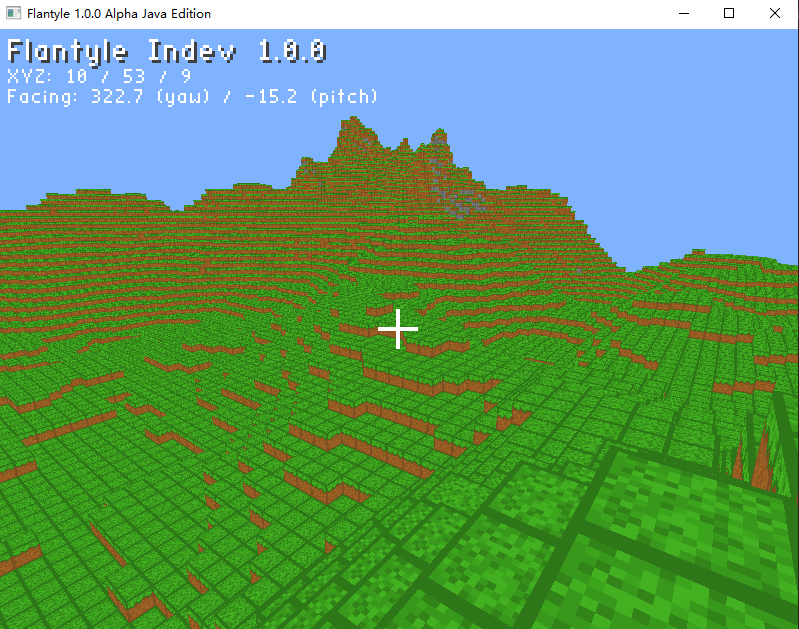

# Flantyle Game


---

## 项目简介

**Flantyle Game** 是一个用 LWJGL + OpenGL 编写的 Minecraft 风格体素引擎，可用于学习如何编写基本的体素引擎。



## 技术栈

| 依赖        | 版本   | 用途                       |
|-------------|--------|----------------------------|
| Java        | 23     | 语言与运行时               |
| LWJGL       | 3.3.3  | GLFW 窗口、OpenGL 3.3、STB |
| JOML        | 1.10.5 | 矩阵与向量                 |
| Maven Shade | 3.5.1  | 打包 fat jar               |

---

## 按键操作

| 按键输入 | 按键行为           |
|----------|--------------------|
| W A S D  | 移动               |
| Space    | 跳跃               |
| Shift    | 下降               |
| 鼠标     | 视角               |
| 左键     | 挖掉准星指向的方块 |

---

## 构建与运行

需要 `JDK 23` 进行构建。

构建：

```bash
mvn clean package
```

运行：

```bash
java -jar target/Flantyle_Java-1.0-SNAPSHOT.jar
```

---

## 已知限制

- 玩家位置和世界坐标用 `float`，超过约 1677 万后精度下降，移动开始抖动
- 区块坐标 `int`，`cx` 超过约 6710 万后 `cx * 32` 溢出
- 没有透明方块、没有光照传播、没有生物
- 结构摆放是覆盖模式，不区分“只填空”
- HUD 只支持 ASCII，不支持中文
- 挖掘方块速度过快

## 代码反馈与贡献

欢迎任何形式的反馈和贡献。无论是报告问题、提建议，还是直接提交代码，都是对项目的帮助。

### 反馈问题

提交 Issue 前，请先搜索是否已有相同问题。提交时请包含：

- **系统信息**：操作系统版本、JDK 版本、显卡型号
- **运行方式**：`java -jar` 还是从 IDE 启动
- **复现步骤**：从启动到出问题的完整操作
- **日志和堆栈**：控制台完整输出，不要只截最后一行
- **截图或录屏**：渲染问题用录屏比文字描述有效得多

如果游戏直接崩溃，把 `hs_err_pid*.log` 一起附上。

### 提出功能建议

新功能请先开 **Discussion** 讨论，说明：

- 想解决什么问题
- 打算怎么做
- 会不会影响现有架构

讨论清楚再动手，避免 PR 写完才发现方向不对。

### 提交代码

```bash
# 1. Fork 仓库
# 2. 从 main 拉分支
git checkout -b feat/your-feature

# 3. 改代码
# 4. 本地构建确认通过
mvn clean package

# 5. 提交
git commit -m "feat: 简要说明改了什么"

# 6. 推送并开 PR
git push origin feat/your-feature
```

PR 描述请写清楚：

- **改了什么**：一句话
- **为什么改**：解决什么问题
- **怎么验证**：截图、日志、测试步骤
- **影响范围**：是否改动公开 API、是否影响存档兼容

### 代码风格

项目没有强制格式化工具，但请遵守现有风格：

- 4 空格缩进，不用 Tab
- 类名 `UpperCamelCase`，方法和变量 `lowerCamelCase`，常量 `UPPER_SNAKE_CASE`
- 一个类一个文件，文件名和类名一致
- 静态字段放在类顶部，`public` 在前，`private` 在后
- 不用 `var`，显式写类型
- 不写多余的注释，方法名和变量名本身要能表达意图

### 不接受的改动

以下改动会被拒绝，请提前避免：

- 引入新的图形库或游戏框架（项目定位是手写引擎）
- 用现成工具替换核心模块（区块系统、结构系统、物理）
- 大规模重命名、格式化和重构混在功能 PR 里
- 添加没有实际用途的抽象层

### 沟通约定

- 对事不对人，技术分歧用代码和文档说话
- 提 issue 和 review 时给出具体理由，不写“这样不好”
- 维护者也是业余时间做这个项目，响应可能不及时，请耐心

---

## 许可证

本项目基于 [MIT License](LICENSE) 开源。